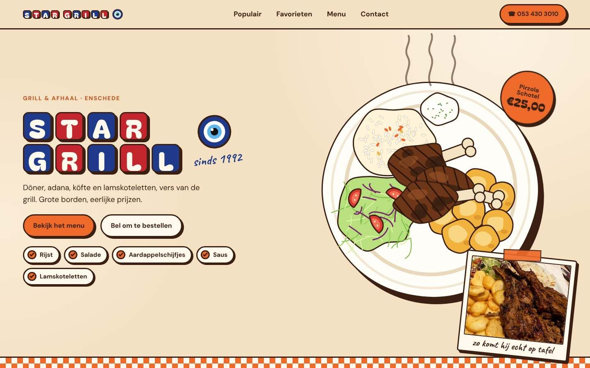
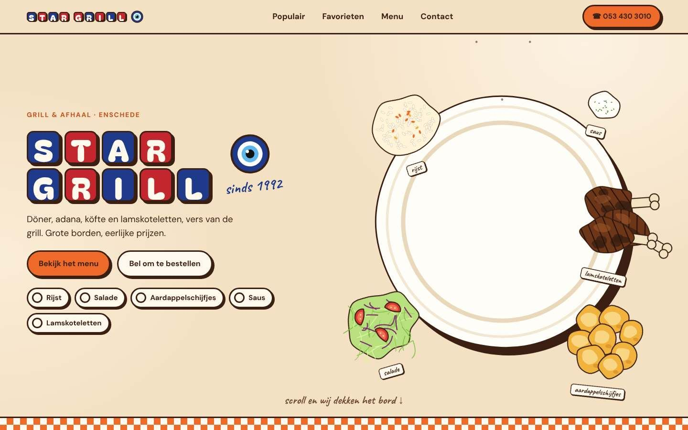
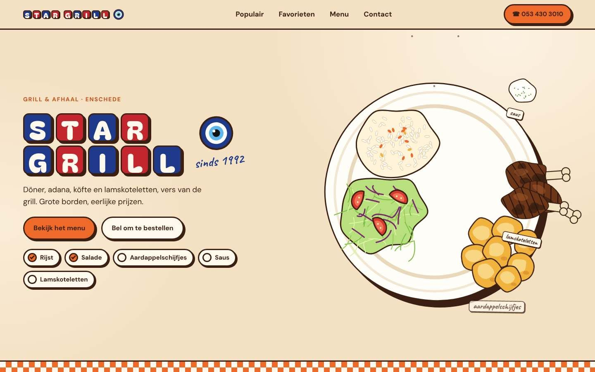
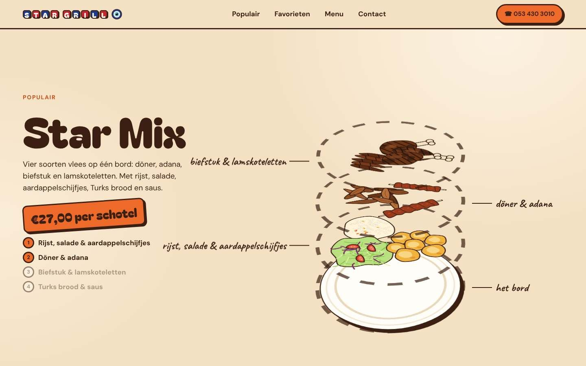
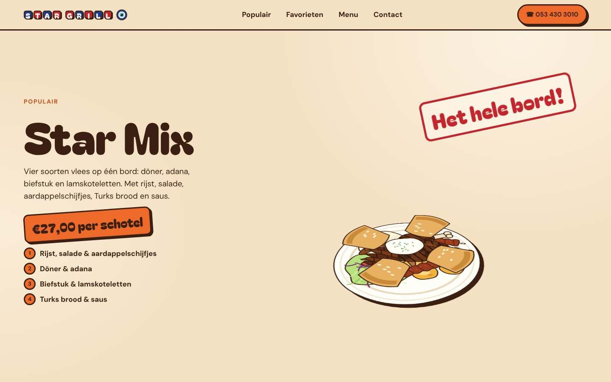
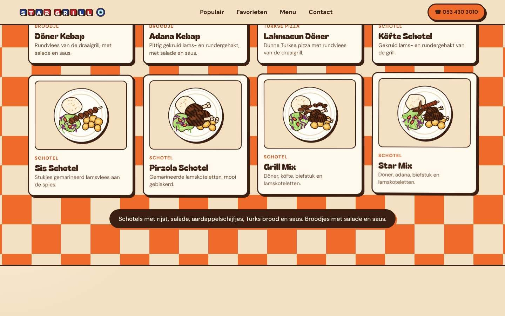
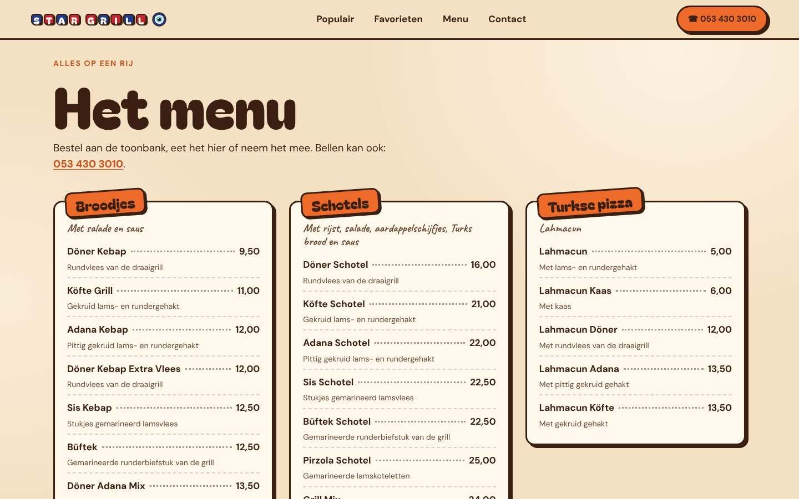
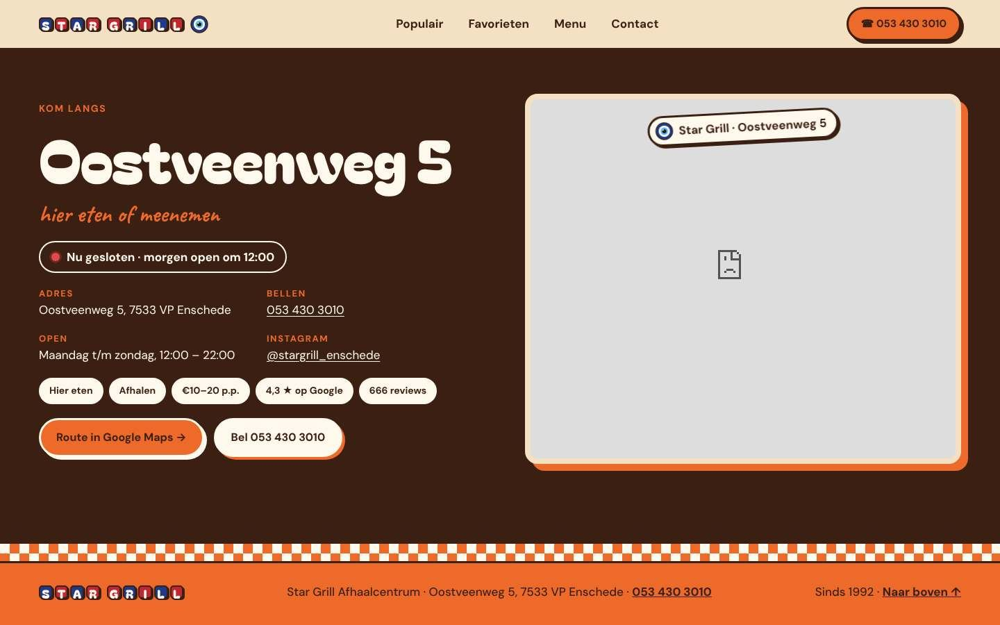
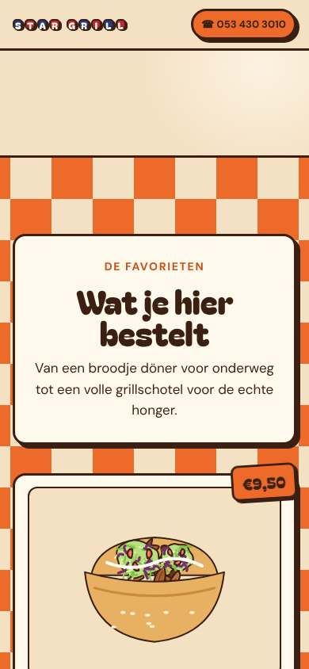

# Star Grill Afhaalcentrum · website

A one-page website for **Star Grill Afhaalcentrum**, a Turkish grill and takeaway at Oostveenweg 5 in Enschede, open since 1992. Big plates, low prices, very good food. The site is warm, playful and hungry-making, never fancy. All text on the site is in Dutch.



## The five sections

| | |
|---|---|
|  |  |
| **1 · Het bord wordt geserveerd.** Their sign rebuilt as red and blue tiles next to an evil-eye charm. As you scroll, the ingredients fly onto an empty plate one by one: rijst, salade, aardappelschijfjes, saus, lamskoteletten. The checklist ticks along. | Then the plate thumps, steam rises, a price sticker pops on, and a polaroid of the **real** Pirzola Schotel slides up: "zo komt hij echt op tafel". |
|  |  |
| **2 · Star Mix, laag voor laag.** Their most popular plate drops in as five tilted layers with handwritten labels. | The layers press together into the full plate and a red stamp thumps on: "Het hele bord!" |
|  |  |
| **3 · De favorieten.** An orange checkerboard flips in from the centre and eight dish cards land with their prices. | **4 · Het menu.** The full menu with every price from their menu card. |



**5 · Kom langs.** Address, phone, hours, Instagram and a route button. A live pill shows "Nu open · tot 22:00" or "Nu gesloten" in Amsterdam time, next to a Google Map.

<p align="center"></p>

## How it's built

- One static page: `index.html`, `styles.css`, `main.js`, `img/`. No build step.
- GSAP 3.13 with ScrollTrigger, and Lenis 1.3.4 for smooth scrolling (in `assets/vendor/`). Sections 1 and 2 are pinned and scrubbed with the scroll on desktop. On phones nothing is pinned and each animation plays as its section scrolls by.
- **All food illustrations are drawn in code** as inline SVG: rice, salad, potato slices, sauce, lamb chops, döner, adana, köfte, steak strips, Turkish bread and lahmacun. Shapes come from a seed, so they look hand-made but identical on every load. The only photos are their two real ones, in `img/`.
- Type: Bagel Fat One (headings), DM Sans (text and prices), Caveat (handwritten labels), self-hosted in `assets/fonts/`.
- Palette: cream `#F4E0C2`, paper `#FFF8EC`, orange `#EE6A2B`, dark orange `#C9501A`, ink `#3A1F12`, sign red `#C3262E`, sign blue `#1F3A8A`, evil-eye blue `#5FB6EC`. Everything has a 3 px ink outline and a hard shadow, like a sticker.
- Schema.org `Restaurant` data with the address, phone, coordinates and opening hours.
- With **reduced motion** on, everything shows in its final state: the full plate, the sticker and polaroid, the stacked Star Mix.

## Run it

```bash
git clone https://github.com/Manolis8/enschede-restaurant.git
cd enschede-restaurant
python3 -m http.server 8000
# open http://localhost:8000
```

On Vercel: import the repo, framework **Other**, no build command (`vercel.json` handles the rest).

## Facts used on the site

From their Google Maps listing and menu card (checked 14 October 2026): Oostveenweg 5, 7533 VP Enschede · 053 430 3010 · every day 12:00–22:00 · dine in and takeaway · €10–20 p.p. · 4,3 ★ from 666 Google reviews · [@stargrill_enschede](https://www.instagram.com/stargrill_enschede). Prices can change; the menu card in the shop is leading.

Made with Claude Code from a written build prompt, following my cinematic-website skill ([on GitHub](https://github.com/Manolis8/claudewebsitedesign/tree/main/.claude/skills/cinematic-website)).
